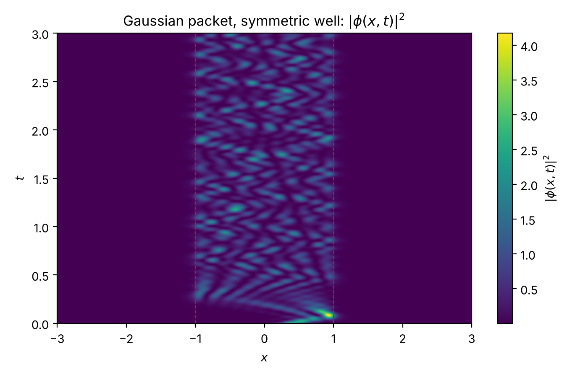
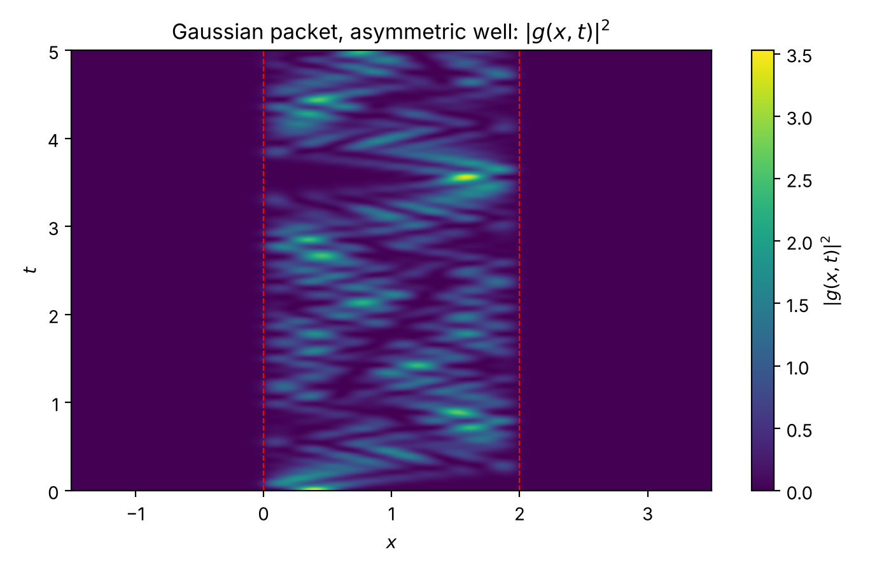
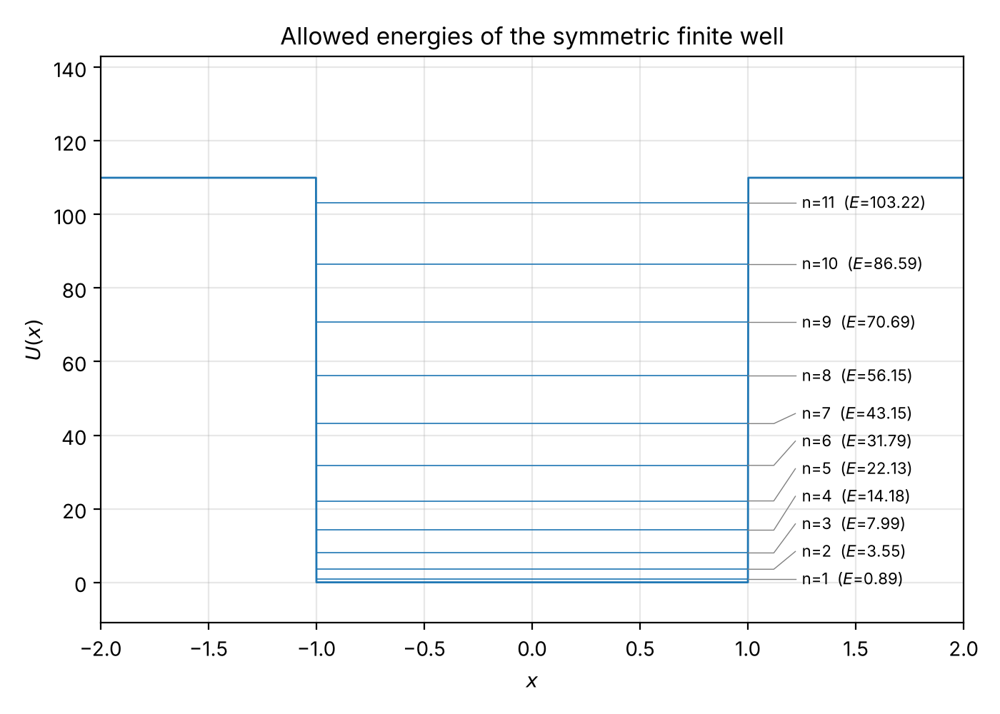
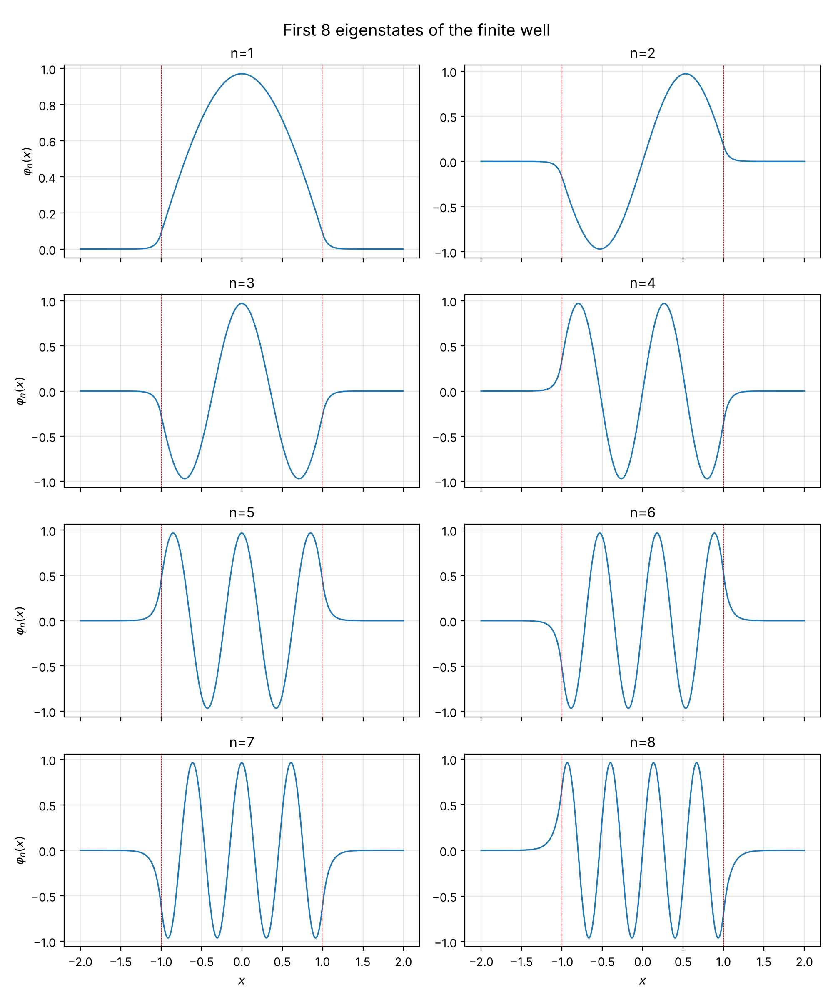
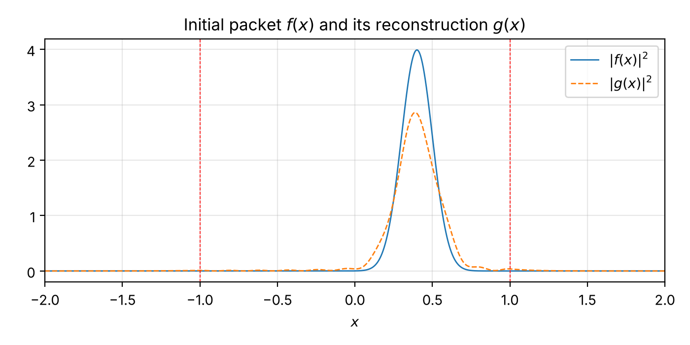
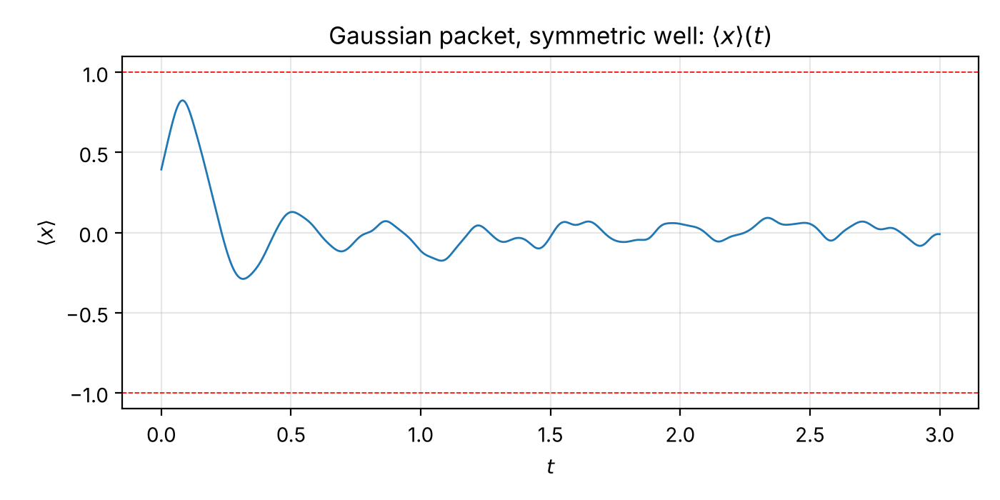
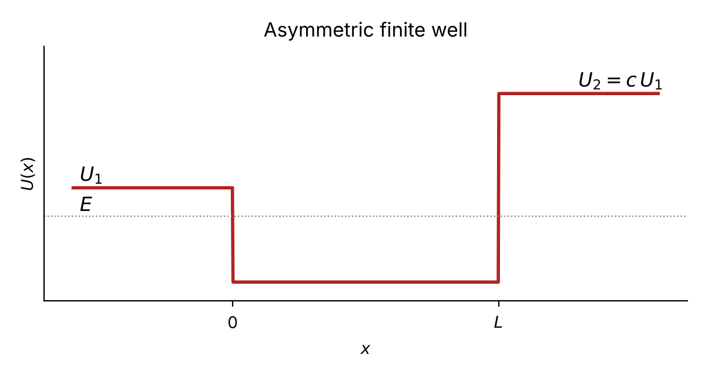
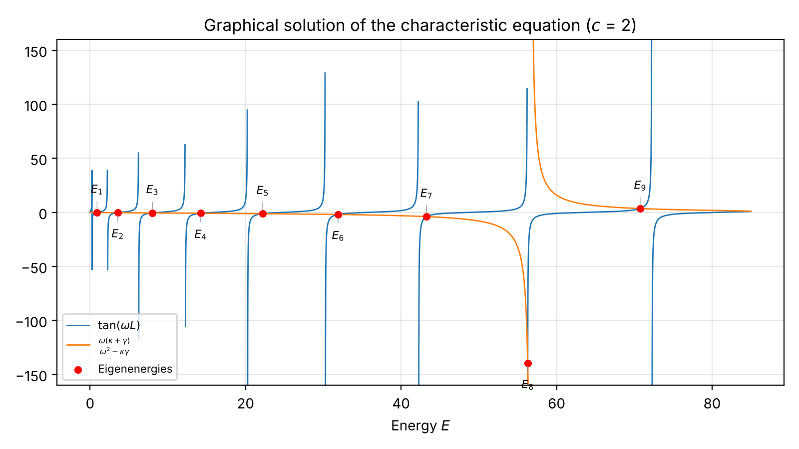
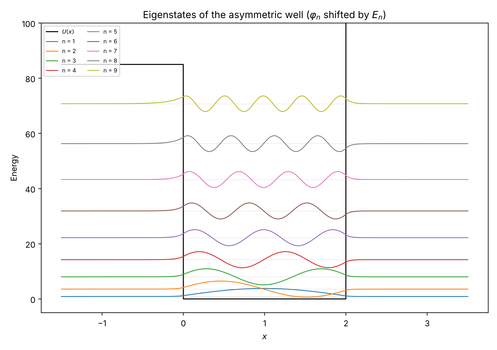
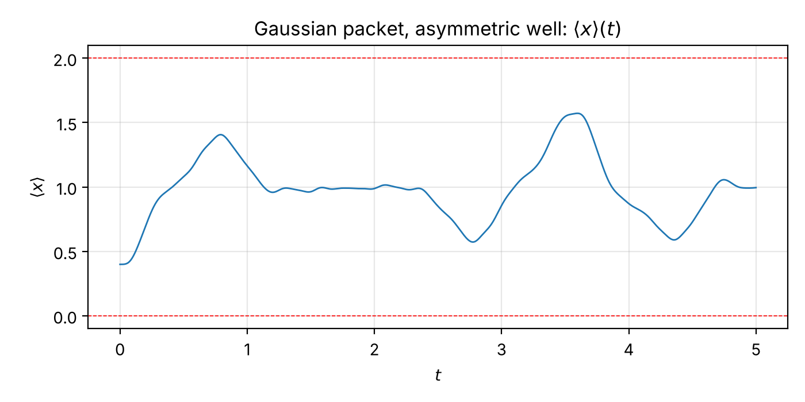

# Dynamics of a Particle in a Finite Quantum Well

Numerical and analytical study of a quantum particle trapped in a one-dimensional **finite potential well**, in its **symmetric** and **asymmetric** versions: bound-state energies, normalized eigenstates, and the time evolution of wave packets built from them.

<p align="center">
  
  
</p>
<p align="center"><i>Probability density of a Gaussian wave packet in the symmetric (left) and asymmetric (right) well.</i></p>

**Course project** · Quantum Systems Analysis (*Análisis de sistemas cuánticos*, Gpo 603) · Tecnológico de Monterrey · October 2026
Instructor: Julio César Gutiérrez Vega

**Authors:** Luis Daniel González Alcocer · Andres Saul Pérez Martínez · Andros Izhar Alvarado Sánchez

---

## Highlights

- **Every bound state** of the symmetric well found from the even/odd characteristic equations, with normalization amplitudes derived analytically.
- A **unified characteristic equation** obtained from a round-trip phase (resonance) argument, which reproduces all energies to within $10^{-11}$.
- **Time evolution** by eigenstate expansion, including the physical loss of a Gaussian packet that cannot be fully represented with bound states only.
- The **asymmetric well**: characteristic equation, number of bound states, cutoff condition, and dynamics.
- Every figure and video in this repository is generated by the code in [`src/`](src/).

## Part 1 — Symmetric finite well

With $\hbar = 1$, half-width $a = 1$, $M = \pi^2/8$ (so the infinite-well ground energy is $V_0 = 1$) and wall height $U_0 = 110$, the well holds **11 bound states**:

| $n$ | 1 | 2 | 3 | 4 | 5 | 6 | 7 | 8 | 9 | 10 | 11 |
|---|---|---|---|---|---|---|---|---|---|---|---|
| $E_n$ | 0.8887 | 3.5531 | 7.9880 | 14.1841 | 22.1268 | 31.7943 | 43.1531 | 56.1502 | 70.6928 | 86.5879 | 103.2200 |

<p align="center">
  
  
</p>

**Unified characteristic equation.** Treating each wall as a potential step that reflects with phase $\gamma = -2\arctan(q/k)$ and requiring a round-trip phase of $2\pi m$ gives a single equation for even and odd states:

$$\mu_n = n - \frac{2}{\pi}\arcsin\left(\frac{\mu_n}{\mu_{\max}}\right), \qquad E_n = V_0\,\mu_n^2,$$

which also shows that the number of bound states is $N = \lceil \mu_{\max} \rceil \geq 1$.

**Gaussian wave packet** ($b = 0.2$, $c = 0.4$, $v_0 = 8$). Only 91 % of the packet can be built from bound states ($\sum |c_n|^2 \approx 0.910$); the remainder corresponds to components above the wall that would leak out as travelling waves.

<p align="center">
  
  
</p>

▶ Video: [`videos/gaussian_packet_symmetric_well.mp4`](videos/gaussian_packet_symmetric_well.mp4)

## Part 2 — Asymmetric finite well

$U(x) = U_1$ for $x < 0$, $0$ inside $0 \le x < L$, and $U_2 = c\,U_1$ for $x \ge L$. 

This results in the following master equation:
```math
\tan(z) = \frac{z\sqrt{z_{\max}^2 - z^2} + z\sqrt{c\,z_{\max}^2 - z^2}}{z^2 - \sqrt{z_{\max}^2 - z^2}\,\sqrt{c\,z_{\max}^2 - z^2}}
```
where
```math
\begin{gathered}
z = \sqrt{\frac{2mE}{\hbar^2}}\,L \\
z_{max} = \frac{L}{\hbar}\sqrt{2mU_1}
\end{gathered}
```


With $L = 2$, $U_1 = 85$ and $c = 2$ the well holds **9 bound states**:

| $n$ | 1 | 2 | 3 | 4 | 5 | 6 | 7 | 8 | 9 |
|---|---|---|---|---|---|---|---|---|---|
| $E_n$ | 0.8916 | 3.5649 | 8.0145 | 14.2309 | 22.1989 | 31.8947 | 43.2797 | 56.2842 | 70.7468 |

Setting $c = 1$ (with $U_1 = U_2 = 110$) recovers the 11 energies of Part 1.

<p align="center">
  
  
</p>
<p align="center">
  
  
</p>

For a Gaussian packet at rest ($b = 0.2$, centre $0.4$, $v_0 = 0$) the bound states capture $\sum|c_n|^2 \approx 0.993$ of the probability.

▶ Video: [`videos/gaussian_packet_asymmetric_well.mp4`](videos/gaussian_packet_asymmetric_well.mp4)

## Repository structure

```
├── src/
│   ├── part1/
│   │   ├── q2_eigenstates.py           energies, eigenstates, overlap matrix
│   │   ├── q3a_superposition.py        evolution of a four-state superposition
│   │   ├── q3b_gaussian_packet.py      Gaussian packet + video
│   │   └── q4b_unified_equation.py     unified characteristic equation
│   └── part2/
│       ├── q6_asymmetric_well.py       asymmetric well: figures + video (Python)
│       └── q6_asymmetric_well.jl       original Julia implementation used in the report
├── figures/
│   ├── part1/
│   └── part2/
├── videos/
├── report/                             LaTeX sources and final PDF (in Spanish)
├── requirements.txt
└── README.md
```

## Reproducing the results

```bash
pip install -r requirements.txt

python src/part1/q2_eigenstates.py
python src/part1/q3a_superposition.py
python src/part1/q3b_gaussian_packet.py      # ~1 min, renders the video
python src/part1/q4b_unified_equation.py
python src/part2/q6_asymmetric_well.py       # ~1 min, renders the video
```

Each script writes its outputs to `figures/` and `videos/`. Video export uses `imageio-ffmpeg`, so no system-wide ffmpeg is required.

The original Julia version of Part 2 can be run from the repository root with `julia src/part2/q6_asymmetric_well.jl` (packages: `Plots`, `Roots`); it writes to `figures/part2/julia/` and `videos/`.

## Report

The full write-up, with all derivations, is in [`report/report.pdf`](report/report.pdf) (Spanish). The LaTeX sources are in [`report/`](report/); see [`report/README.md`](report/README.md) for its layout.
