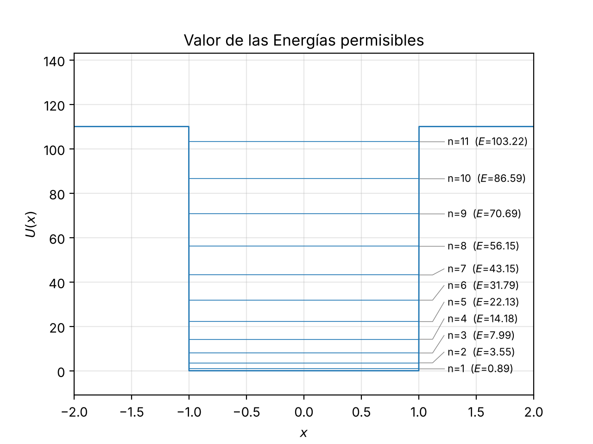
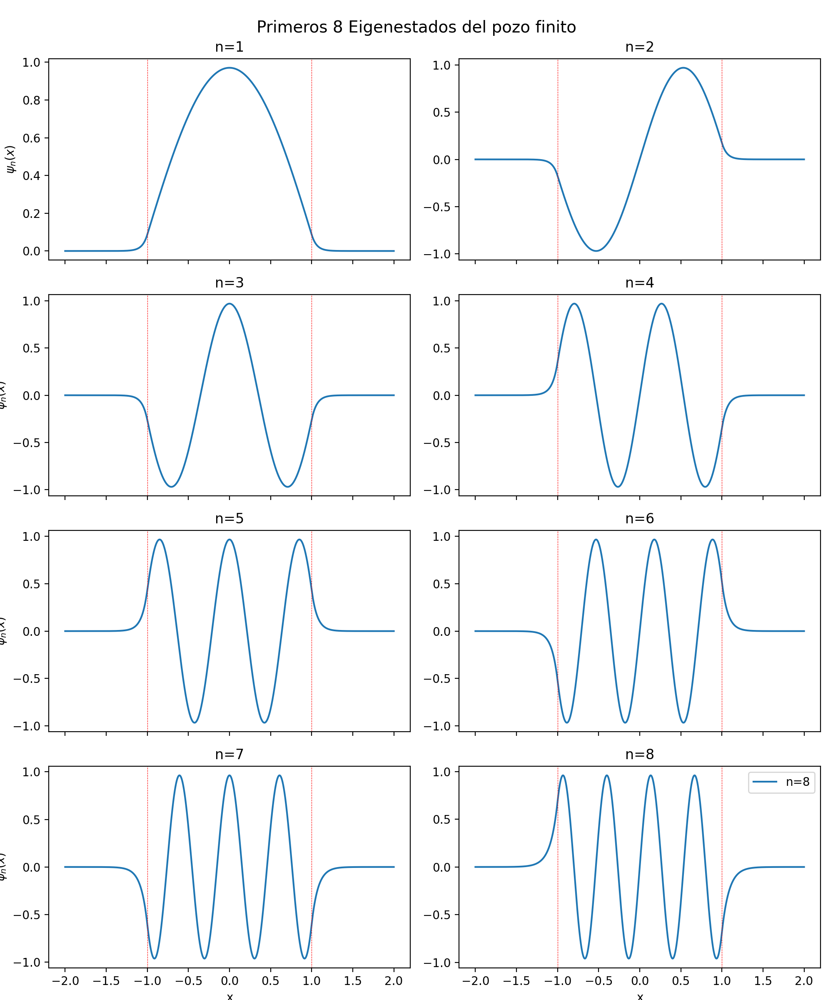
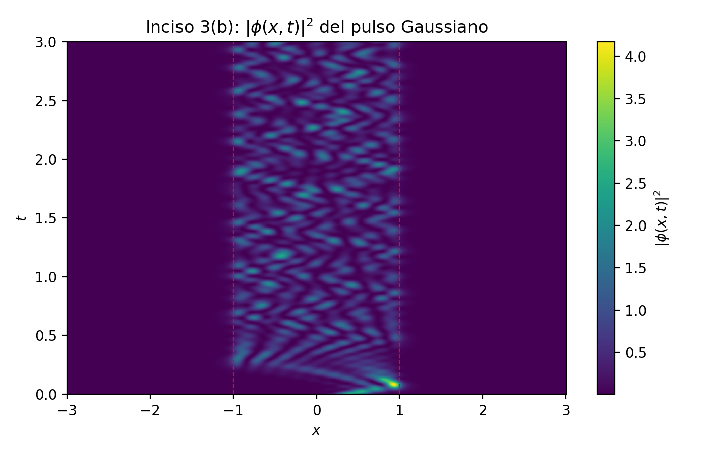
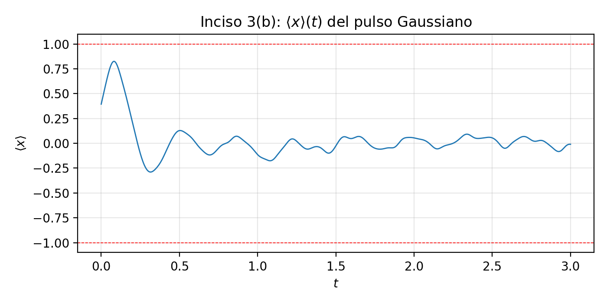
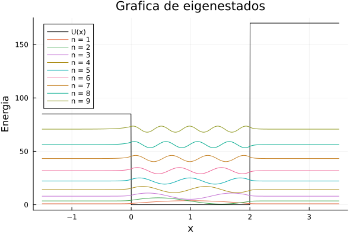
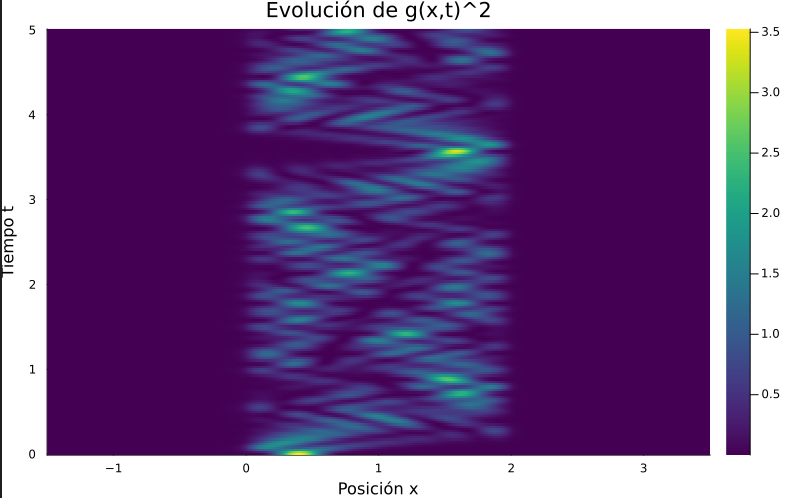

# Mini-proyecto 1 · Mecánica Cuántica

**Sistemas simples en 1D: dinámica del pozo finito de potencial simétrico y asimétrico**

Tecnológico de Monterrey · Fundamentación de la electrodinámica (Gpo 601)
Profesor: Julio César Gutiérrez Vega · Octubre 2026

| Integrante | Matrícula |
|---|---|
| Luis Daniel González Alcocer | A01286903 |
| Andrés Saul Pérez Martínez | A01199376 |
| Andros Izhar Alvarado Sánchez | A00842107 |

---

## Entregables

| | Archivo |
|---|---|
| Reporte (PDF) | [`reporte/miniproyecto1.pdf`](reporte/miniproyecto1.pdf) |
| Video, pulso Gaussiano en el pozo simétrico | [`videos/pulso_pozo_simetrico.mp4`](videos/pulso_pozo_simetrico.mp4) |
| Video, pulso Gaussiano en el pozo asimétrico | [`videos/pulso_pozo_asimetrico.mp4`](videos/pulso_pozo_asimetrico.mp4) |
| Fuentes LaTeX | [`reporte/`](reporte/) |

## Contenido

**Parte 1. Pozo finito simétrico**
1. Normalización analítica de las amplitudes $A_n$ y $B_n$ de los estados pares e impares.
2. Eigenenergías y eigenestados para $U_0 = 110$, con verificación de ortonormalidad.
3. Evolución temporal por expansión en eigenestados: (a) superposición de cuatro estados, (b) pulso Gaussiano.
4. Ecuación característica unificada a partir de la condición de resonancia de fases y su verificación numérica.

**Parte 2. Pozo finito asimétrico**
1. Forma general de las eigenfunciones y ecuación característica.
2. Número de estados atrapados y condición de corte.
3. Normalización de las amplitudes.
4. Energías, eigenestados y evolución del pulso Gaussiano para $c = 2$.

**Reflexión final individual.**

## Resultados principales

### Parte 1: pozo simétrico

Con $\hbar = 1$, $a = 1$, $M = \pi^2/8$ (de modo que $V_0 = 1$) y $U_0 = 110$, el pozo tiene **11 estados atrapados**:

| $n$ | 1 | 2 | 3 | 4 | 5 | 6 | 7 | 8 | 9 | 10 | 11 |
|---|---|---|---|---|---|---|---|---|---|---|---|
| $E_n$ | 0.8887 | 3.5531 | 7.9880 | 14.1841 | 22.1268 | 31.7943 | 43.1531 | 56.1502 | 70.6928 | 86.5879 | 103.2200 |

La ecuación característica unificada $\mu_n = n - \tfrac{2}{\pi}\arcsin(\mu_n/\mu_{\max})$ reproduce estas energías con diferencias menores a $10^{-11}$.

<p align="center">
  
  
</p>

El pulso Gaussiano ($b = 0.2$, $c = 0.4$, $v_0 = 8$) solo se puede representar en un 91 % con los estados atrapados ($\sum|c_n|^2 \approx 0.910$); el resto corresponde a componentes que escapan del pozo.

<p align="center">
  
  
</p>

### Parte 2: pozo asimétrico

Con $L = 2$, $U_1 = 85$ y $U_2 = cU_1$ con $c = 2$, el pozo tiene **9 estados atrapados**.

<p align="center">
  
  
</p>

## Estructura del repositorio

```
miniproyecto1-cuantica/
├── README.md
├── requirements.txt
├── codigo/
│   ├── inciso2.py           Parte 1, inciso 2: energías, eigenestados y matriz de traslape
│   ├── inciso3a.py          Parte 1, inciso 3(a): superposición de cuatro estados
│   ├── inciso3b.py          Parte 1, inciso 3(b): pulso Gaussiano y video
│   ├── inciso4b.py          Parte 1, inciso 4(b): ecuación característica unificada
│   └── parte2_inciso6.jl    Parte 2, inciso 6: pozo asimétrico (Julia)
├── figuras/                 Figuras generadas por los scripts de Python
│   └── parte2/              Figuras de la Parte 2
├── videos/                  Animaciones en mp4
└── reporte/                 Fuentes LaTeX y PDF final
```

## Cómo reproducir los resultados

**Python (Parte 1)**

```bash
pip install -r requirements.txt
python codigo/inciso2.py
python codigo/inciso3a.py
python codigo/inciso3b.py      # también genera videos/pulso_pozo_simetrico.mp4
python codigo/inciso4b.py
```

Cada script es independiente y guarda sus figuras en `figuras/`. Para generarlas sin abrir ventanas: `MPLBACKEND=Agg python codigo/inciso3b.py`.

**Julia (Parte 2)**

```julia
using Pkg; Pkg.add(["Plots", "Roots"])
include("codigo/parte2_inciso6.jl")
```

**Reporte**

Las fuentes están en `reporte/`; el documento principal es `reporte/miniproyecto1.tex`. Ver [`reporte/README.md`](reporte/README.md) para compilarlo.
